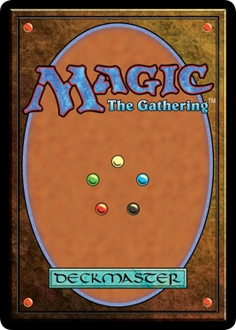

# portfolio-the-gathering

Project Changelog & Notes - TCG Portfolio

This document tracks the iterative development of the React-based Magic: The Gathering style interactive portfolio.

Feature History & Updates

1. Hover Animations & Dynamic Preview Positioning

Request: Make the hand card hover animation less aggressive. Position the large preview card dynamically above hand cards, and floating smartly next to battlefield/commander cards so it doesn't clip off-screen.

Changes:

Adjusted the CSS transform on HandCard to scale and translate gently.

Replaced fixed preview pane with a dynamic coordinate calculation (previewStyle) in the main App component based on the hovered card's bounding box.

2. Drag & Drop Offset Fix

Request: Fix the bug where dragged cards snap downwards and don't center properly on the mouse cursor.

Changes: Updated the offsetX and offsetY drag calculations to use getBoundingClientRect() to measure the exact distance from the mouse to the unscaled card's top-left corner.

3. "The Resume" Card Identity

Request: Change "The Resume" from an Artifact to a Red Enchantment costing 2 R.

Changes: Updated the CARDS database entry, changing colors, types, mana cost, and rules text.

4. Card Draw Engine & "Orianna" Custom Card

Request: Make "Portfolio Site" draw a card when played, decrement the library, and specifically draw a Secret Lair reskin of "Helpful Hunter" named "Orianna" with a cat picture and custom flavor text.

Changes:

Added the libraryCount state.

Added "Orianna" to the CARDS array.

Added ETB logic in handlePointerUp so playing Portfolio Site draws Orianna and reduces the library count.

5. Starting Library Math & "My Hobbies" (Infernal Grasp)

Request: Adjust the starting library to 93 (99 cards total minus 7 in hand). Add "My Hobbies" (reskin of Infernal Grasp) which deals 2 damage to the player when played.

Changes:

Added life state (starts at 40) and red flash animation.

Fixed starting hand to properly include 7 initial cards.

Added logic so playing "My Hobbies" dynamically reduces the life total by 2.

6. The Graveyard Zone

Request: Add a designated Graveyard zone below the library. Instants and Sorceries should go there automatically when played.

Changes:

Created a graveyardIds array state.

Built the Graveyard UI box below the library deck.

Updated game logic so Sorceries/Instants enter the graveyard stack instead of sticking to the battlefield.

7. Interactive 3D Preview Hologram

Request: Allow the user to move their mouse off a card and onto the large preview pane without it disappearing, and add a 3D tilt effect to the preview.

Changes:

Added a 100ms setTimeout to the onMouseLeave event.

Enabled pointer-events: auto on the preview container.

Added 3D CSS transforms triggered by onMouseMove directly on the MTGCardPreview component.

8. Custom Asset Integration (Orianna & Card Backs)

Request: Use local image assets (orianna.jpg and back.jpg) instead of generic icons and procedural CSS gradients. Fix the image cropping for the portrait cat photo.

Changes:

Updated the card renderer to accept custom image tags.

Set Orianna's image to object-contain and duplicated it as a blurred background layer to prevent black pillarboxing.

Replaced the procedural library deck art with .

9. Interactive Graveyard Drop-Zone

Request: Allow dragging and dropping cards directly from the hand or battlefield into the graveyard stack, incrementing its count.

Changes: Utilized document.elementFromPoint during the onPointerUp event to detect if the mouse was released over the #graveyard-zone, updating states manually.

10. Late-Game Board Initialization & Tapping Mechanics

Request: Start the game with "Omniscience" and 10 basic lands (2 of each color) on the board. Make the lands fan out horizontally, disable their hover previews, and allow them to "tap" when clicked. Update library math.

Changes:

Added basic lands to the CARDS array.

Calculated a dynamic horizontal fan-out based on window width for the initial boardCards state.

Excluded basic lands from triggering handleMouseEnter.

Added an isTap mathematical check (mouse traveled < 5 pixels) to trigger a 90-degree rotate CSS class instead of picking the card up.

Updated starting library count to 81 (99 - 7 hand - 11 board).

11. Interactive Resume Modal

Request: Summarize actual achievements on "The Resume" flavor text. Make it so clicking/tapping the card on the battlefield opens the full document (eventually settling on Rosie_Choi.png for broad compatibility).

Changes:

Updated the string in the database.

Added a showResumeModal boolean state.

Created a heavily-themed popup overlay containing the high-res, natively scrollable image.

12. Graveyard Recovery Engine (Regrowth)

Request: Add a new card drawn by Orianna's ETB trigger that returns a card from the graveyard to the hand.

Changes:

Created "Version Control" (Secret Lair Regrowth - 1 G Sorcery).

Updated Orianna's drop logic to add Version Control to hand.

Updated Version Control's drop logic to pop the last item off the graveyardIds array and push it into the handIds array, then put itself into the graveyard.
